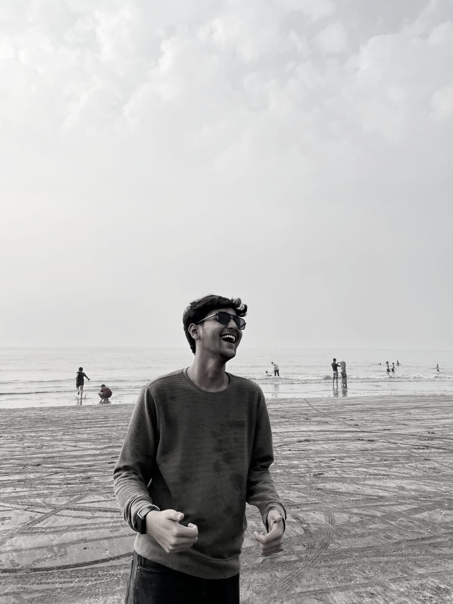

<table>
<tr>
<td width="62%" valign="top">

# hey, i'm Aryan Lokare 

I enjoy experimenting with new ideas, solving problems, and turning rough concepts into something real.

[github](https://github.com/Aryn-Lokare) ·
[linkedin](https://www.linkedin.com/in/aryan-lokare/) 
[email](aryanlokare077@gmail.com)

---

> full-stack-applications | ai-agents | systems-thinking 

I'm a Information Technology student who enjoys building
products, turning ideas into working software.

i believe the best way to learn is by building.
i enjoy taking ideas from concept to implementation,
solving problems along the way and continuously improving
my engineering skills.

</td>

<td width="38%" valign="top">

</td>
</tr>
</table>

---
## tech stack

  
  
  
  
  

